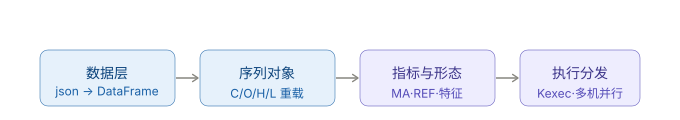

# Klang
stock K-line language 

Klang 是一门**股票 K 线编程语言**，专注快捷的股票筛选与公式编写：一条公式就能完成选股、择时和形态识别，是股票编程与量化交易的趁手工具。

它最大的亮点是**支持中文编程**——`今日收盘 > 昨日收盘` 这样的表达式本身就是合法代码，一看就懂，完整例子见文末。

## Klang 拥抱 AI

在 AI 兴起的今天，Klang 选择拥抱 AI。你不必从头学语法：只要把仓库里的 [SKILL.md](SKILL.md) 交给 AI 助手，它就能掌握 Klang 的数据准备、公式写法与工具链。之后在 agent 里直接用自然语言下指令：

> 请帮我找出今天涨停的、倍量的股票。

agent 会自动调用 Klang 完成行情扫描、公式计算，并把结果整理好交给你。这套流程已在 **WorkBuddy** 中测试通过。

任何问题欢迎访问[问答社区](https://forum.klang.org.cn)

## 核心逻辑



从左到右看这条链路：数据层把 HTTP JSON 落成 DataFrame；序列对象层用 `C/O/H/L` 的运算符重载，让 `C[1]`、`C>C[1]` 这类整序列表达式成立；指标与形态层在这之上实现 MA/REF 等通达信公式和 W 底、杯柄等形态识别；最上层的 `Kexec` 解释中文公式，配合 socketio 把全 A 股扫描分片到多台机器并行执行。

# 在线试用
* 内置中文编程公式
启动本地服务后打开 <http://127.0.0.1:9088/studio>，无需安装额外前端，页面内置了多个选股公式，可直接运行测试。

```bash
python3 server/kws_manager.py   # 终端 1：管理端 + 网页（端口 9088）
python3 server/kws_server.py    # 终端 2：计算节点（可再开 5 个并行加速）
```

公网旧入口仍为 <https://klang.org.cn/online.html>；本地旧界面为 `/online.html`。详见 [server/README.md](server/README.md)。


## Klang 是股票K线形态语言,基于 python3
* 语言解释器采用 python的 ply库，他采用了flex，yacc语法的实现
* 股票数据来源 eltdx（通达信），只读本地缓存；数据下载见 tools/
* 支持 同花顺、通达信、文华财经等的公式, 感谢funcat 移植到了 Python 版本
* Klang 语言是基于Python语法拓展了部分自己的语法，并且编写了快捷的股票公式 
* 支持网页直接使用,交互方便
* 支持中文编程,一看就懂
* 增加了股票特征计算

## 增加pattern代码
   通过zigzag 折点实现模型识别。 支持W底，支持V型反转，支持杯柄（cup-handle）算法

## 麦语言 文华财经， 通达信，同花顺公式支持列表
   * DNULL,DRAWNULL,REF,REFDATE,CROSS
   * HHV,LLV,IIF,MIN,MAX,EVERY,EXIST,COUNT,SMA,MA,ABS,MACD,RSI,BOLL,
   * KDJ(STOCH),SUM,STD,EMA,WMA,APPROX,FORCAST,SLOPE,ALIGNRIGHT,AMA

### 其他函数
   * CODELIKE,INBLOCK,NAMELIKE

### 未来函数
   * BACKSET

### 引用函数
   * BARSLASTCOUNT ,BARSCOUNT,BARSLAST,BARSLASTFIND,BARSNEXT,
   * BARSSINCE,BARSSINCEN,CALCSTOCKINDEX,CURRBARSCOUNT


#### 未实现列表
   * EXTERNSTR,EXTERNVALUE,SIGNALS\_USER,BARSTATUS,CONST

# 安装
```
git clone https://github.com/asmcos/Klang.git
cd Klang
pip3 install -r requirements.txt 
python3 setup.py install
```

## 下载数据, 也可以直接使用不下载数据，下载数据约10分钟。
* 可以跳过，直接运行
* 数据更新通过 eltdx（通达信行情）下载，需先安装：`pip3 install eltdx`

```
# 只更新日K（日常使用）
python3 tools/eltdx_updater.py

# 全量下载日/周/月K线
python3 tools/eltdx_updater.py --all

# 只更新指定股票
python3 tools/eltdx_updater.py --codes sh.600000 sz.000001
```

# 在 AI 助手（WorkBuddy 等）中使用

仓库自带一份 [SKILL.md](SKILL.md)，把 Klang 的安装、数据下载、Python API、中文公式写法、
网页服务模式和踩过的坑都写清楚了。AI 助手读到这个文件就会知道怎么用 Klang。

```bash
# 安装到自己的 WorkBuddy
mkdir -p ~/.workbuddy/skills/klang-quant
cp SKILL.md ~/.workbuddy/skills/klang-quant/SKILL.md
```

装好之后可以直接对助手说「用 Klang 找今天涨停的股票」「用 Klang 算一下 XX 的均线」。

**给 agent 的最短路径**：先读 [examples/agent_formulas.md](examples/agent_formulas.md)（五份可复制公式 + 四条硬约束），
再跑 `python3 examples/formula_examples.py --list` 验证环境。这份样例脚本可直接运行，比从 README 猜语法快得多。

现成的选股脚本：

```bash
python3 tools/limit_up.py            # 今日涨停
python3 tools/limit_up.py --down     # 今日跌停
python3 tools/limit_up.py --broken   # 炸板（盘中触及涨停未封住）
```


# 应用示例 python  版本
* 第一次会下载数据,预计需要几分钟,推荐先用上面的步骤下载数据后再执行
* 具体例子可以看 
```
python3 examples/test.py
python3 examples/testparse.py
```

```
from Klang import Klang,C,O
Klang.Klang_init()
Kl = Klang.Kl
C/C[1]

```
以上代码就快捷的计算了今日收盘价/昨日收盘价
默认计算第一个股票 sh.600000
今日收盘价，更新时间为下午5点左右

### 设置当前股票 'sh.601012','sz.000100'

```
Kl.code('sh.601012')
```
你也可以设置你想要的股票code

### 设置时间，周期默认是 2021-01-01开始
* 默认数据是日K

```
Kl.date(start='2022-04-02',end='2022-11-01')
```

### 显示收盘价

```
print(C.data) #显示已经下载周期的所有收盘价
print(O.data) #显示所有周日的开盘价
```

### 通过日期索引股票价格

```
print(C.['2022-05-20'])
```

### 收盘价涨幅

```
print((C-C[1])/C[1]) #当前周期的收盘 比上一个周一的收盘价涨跌比率
```

### REF 和通达信兼容，获取之前周期的价格

```
REF(C,5) # 5周期前的收盘价，5日前收盘价
```

### 同时实现了MA,SMA,HHV,LLV,ABS等


## Klang 语言(K浪)
* testparse.py 代码片段

```
from Klang.lang import kparser,setPY,Kexec
from Klang import Klang
Klang.Klang_init()
# Klang和python的桥梁，支持函数,变量共享
# 具体使用方法 参见 testparse.py

def getpyglobals(name):
    return globals().get(name)

def setpyglobals(name,val):    
    globals()[name]=val


setPY(getpyglobals,setpyglobals) 

```

###  执行 K语言语句
* 赋值
```
pi = 3.14 #python
Kexec("ABCD=pi+1;") #调用K语言执行，执行后K变量共享给了python

```
调用 Kexec执行Klang语法，Kexec参数里穿的字符串语法遵守Klang语法规则


### 执行一段代码
* 详细例子参见 python3 examples/testparse.py
* 这里我们定制了一段kloop...endp，表示循环计算所有的A股
```
testblock=\
"""
kloop
ret = CROSS(C,MA(C,60))
ma5 := MA(C,5)
ma10 = MA(C,10)
ma20 = MA(C,20)
ma60 = MA(C,60)
ret1 = (C - C[1])/C[1]
ret2 = (C - C[1])/C[1] > 0.05
info = getstockinfo(0)
if ma60[-1] < ma20[-1] and ma20[-1] < ma10[-1] and ma10[-1] < ma5[-1] and ret2 :
    print(info,ret1*100)
endp
print("计算完成")
"""

Kexec(testblock)

```


### 支持功能列表
* 逐步兼容通达信公式，C,MA,CROSS
* 兼容 := 赋值语法
* 支持兼容 python函数,getstockinfo等 getstockinfo是在python里面自定义的函数
* kloop,endp 是自定义语法，会遍历整个A股的股票，


### server 
* 使用了网页+ socketio server模式
* server里调用 Kexec执行 所有的输入
* 默认的输入会扫描所有的A股4000多只股票
* 计算结果回传到网页界面显示

```
python3 server/kws_manager.py 
python3 server/kws_server.py
```

两个服务同时启动，可以Linux使用 "&" 放到后台
```
python3 server/kws_manager.py
```

* 如果kws_server.py启动出错可以有2种方法。
* 方法一、 安装Klang

```
python3 setup install
```

* 方法二、 打开kws_server.py里面注释,路径为Klang放置的地方
```
#sys.path.append(os.path.expanduser("~") + "/Klang")

```

管理端同时也提供网页，打开 <http://127.0.0.1:9088/studio>（新界面，推荐）或 `/online.html`（旧界面）。
新界面带公式样例、全市场/单票运行、实时结果表格、过滤与 CSV 导出；详细的 Socket.IO 协议和文件职责见 [server/README.md](server/README.md)。

当前在用的一直是 `kws_manager.py` + `kws_server.py`（Socket.IO）。改用 socket.io 之前的原生 WebSocket 旧版 `*_ws.py` 已于 2026-11-25 删除，需要时可查 git 历史。

## 支持中文编程

```

        涨停 = 9.9
        今日收盘 = C
        昨日收盘 = C[1]
        日期范围 = date
        显示 = DISPLAY
        ###############################
        # 参数涨停,表示涨幅的幅度
        # 以上为参数的值可以修改
        # 日期范围('2021-01-01','2021-06-25')
        ###############################

        实际涨幅 = (今日收盘-昨日收盘) / 昨日收盘
        实际涨幅 = 实际涨幅 * 100
        if 实际涨幅 > 涨停:
            显示(实际涨幅)
```

# 更新
* 2026.11.25 新增 agent 公式样例与可执行脚本；server 配套新网页 `/studio`（公式样例、单票/全市场运行、结果表格与 CSV 导出），修复计算节点路径、完成信号与错误回传；新增 `server/server.log` 落盘日志；删除原生 WebSocket 旧版 `*_ws.py`
* 2026.11.24 数据层重构：import 不再联网，只读本地缓存；数据下载改用 eltdx（通达信）；
  新增 tools/limit_up.py 涨停扫描与 SKILL.md（AI 助手使用指南）
* 2022.10.19 server 换成socket.io通讯协议
* 2022.10.17 全面采取了分片执行，真正实现了多服务器并行工作
* 2021.12.1 增加了特征提取公式
* 2021.7.3 增加了板块和概念信息，板块来自通达信


# 文件说明
```bash
tree server/ examples/ Klang
server/
├── __init__.py
├── README.md              # 协议、网页界面与文件职责
├── kws_manager.py         # 当前在用：Socket.IO 管理端 + 静态网页
├── kws_server.py          # 当前在用：计算节点
├── klang_studio.html      # 新网页界面（/studio）
├── online.html            # 旧网页，仍可用
├── vendor/
│   └── socket.io.min.js   # 本地 socket.io 客户端，离线可用
examples/
├── agent_formulas.md      # 给 AI agent 的公式样例与硬约束
├── formula_examples.py    # 可直接运行的公式样例
├── test_feature.py
├── testparse.py
├── test.py
└── test_tdx_api.py
Klang
├── common.py
├── data_klang.py
├── __init__.py
├── Kdatas.py
├── Kfeature.py
├── Klang.py
├── KSeq2Feature.py
├── lang
│   ├── __init__.py
│   ├── klex.py
│   ├── kparse.py
│   └── mAST.py
├── pattern
│   ├── patterns.py
│   ├── zigzag.js
│   └── zigzag_lib.py
└── tdx.py

```


